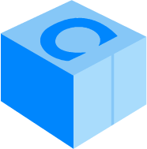
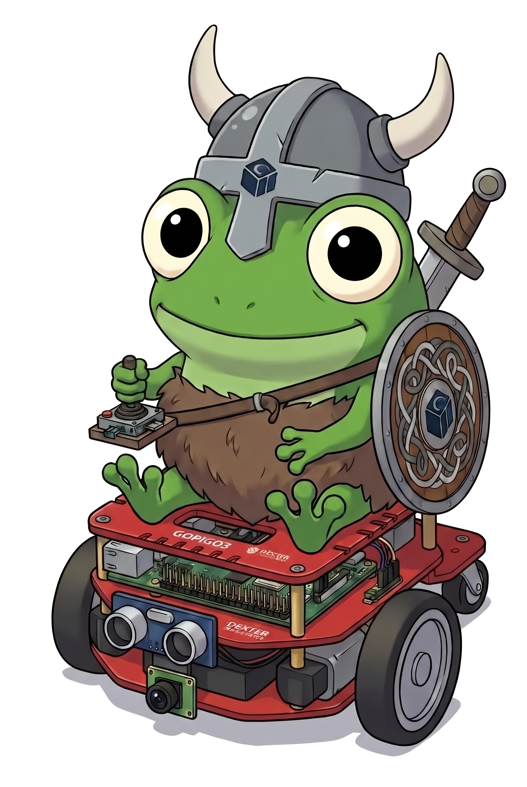
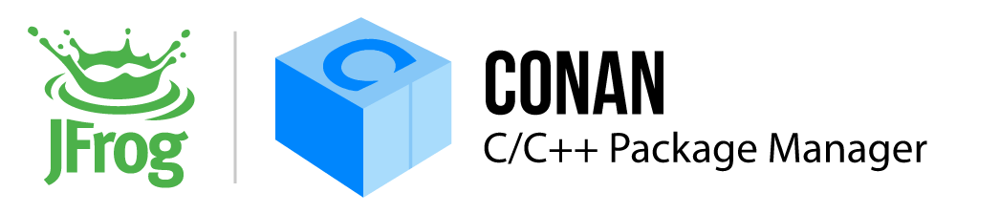
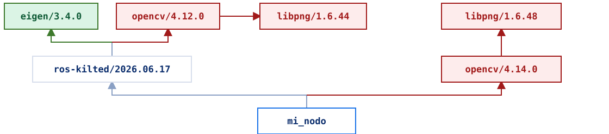
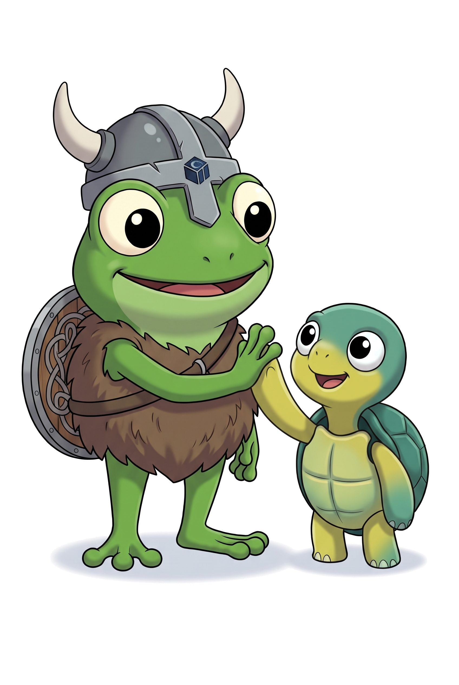

<!-- _class: hero mascota -->
<!-- _footer: "[ `conan.io`](https://conan.io) [`github.com/conan-io/ros-conan`](https://github.com/conan-io/ros-conan)" -->
<!-- _paginate: false -->
<!-- _header: "" -->





###### ROSCon España 2026 · Valencia

# ROS sin rodeos

## Desarrollo nativo en *C++* para robótica

**Daniel Manzaneque**
Ingeniero Software · Conan / JFrog

<!--
⏱ 0:00 → 0:40
Hola a todos. Soy Daniel Manzaneque y trabajo como ingeniero de software en el equipo de Conan, en JFrog.

Soy ingeniero industrial y, antes de dedicarme al software, trabajé con robots. De hecho, mi tesis la hice con ROS 1, en tiempos de Indigo.

Hoy os quiero contar cómo usar ROS sin rodeos: una experiencia de desarrollo nativa en C++.
-->

---

###### De dónde venimos...

## Un robot pequeño con un ordenador *modesto*

- Una placa con pocos recursos (tipo Raspberry Pi)
- Control y percepción escritos en **C++**
- **ROS 2** para hablar con sensores, herramientas y otros equipos


<!--
⏱ 0:40 → 1:15
Para contarlo voy a usar un ejemplo que nos acompañará toda la charla: un robot pequeño, con un ordenador modesto, tipo Raspberry Pi.

Buena parte del software ya está hecho en C++: el control de bajo nivel de los motores y la lectura de los sensores.

Y en algún momento quise añadirle ROS 2, para que hablase con otros nodos y herramientas. Pero...
-->

---

###### El punto de partida

## «Solo quería publicar un topic desde mi código *C++*»

Antes de escribir una línea útil, hay que:

1. Tener la versión de Ubuntu que pide la distro
2. Instalar con `apt` y `rosdep` todo lo demás
3. Crear un workspace de colcon con su estructura
4. Escribir `package.xml` y adaptar el CMake a `ament_cmake`
5. Acordarse de hacer `source setup.bash`
6. ...

**Demasiadas cosas antes de llegar al robot**

<!--
⏱ 1:15 → 1:55
Yo solo quería que mi código C++ hablase ROS. Que pudiera comunicarse con otros nodos para tareas más complejas, como navegación o SLAM, o para incorporar otros sensores.

Pero antes de escribir una sola línea útil tenía que usar la versión de Ubuntu que pide la distro. Instalar un montón de paquetes de sistema que ni sabía para qué servían. Crear un workspace, convertir mi proyecto en un paquete de ROS y acordarme de ejecutar los scripts de entorno.

Demasiadas cosas antes de llegar al robot.
-->

---

<!-- _class: cards -->

###### El mapa de la charla

## Tres rodeos *prescindibles*

1. **Instalar** ROS se instala en el sistema → ROS pasa a ser **una dependencia más**.
2. **Desarrollar** Tu proyecto se adapta a ROS → Tu **proyecto C++ de siempre**.
3. **Desplegar** Compilar en el robot y cruzar los dedos. → **Construir fuera**, llevar solo lo necesario.

<!--
⏱ 1:55 → 2:45
A estos pasos los llamo rodeos: cosas que haces no porque aporten algo a tu robot, sino porque la herramienta te lo exige.

Después de un tiempo volví a ROS y vi que la experiencia seguía siendo muy parecida. En el equipo de Conan nos fijamos en tres rodeos que creemos que se pueden evitar.

Al instalar: en lugar de instalar ROS en el sistema, tratarlo como una dependencia más, como cualquier librería.

Al desarrollar: en lugar de adaptar tu proyecto a ROS, seguir con tu proyecto C++ de siempre.

Y al desplegar: en lugar de compilar en el robot y cruzar los dedos, construir fuera y llevar solo lo necesario.
-->

---

<!-- _class: herramienta -->

###### La herramienta

## Conan, el gestor de paquetes *open source* de C y C++

#### Código abierto (MIT)
- Mantenido el equipo de Conan en JFrog con el feedback de la comunidad

#### Cada librería es una **receta**
- Hay miles en ConanCenter (repositorio central) y puedes crear las tuyas.

#### Agnóstico al build-system
- Compatible con CMake, Bazel, Meson, MSBuild...

#### Resuelve el **grafo** completo de dependencias transitivas
- Obtiene un **binario por configuración**. Puede compilar desde fuentes.


<!--
⏱ 2:45 → 4:15
Y aquí entra Conan, la herramienta que nos permite hacer todo esto.

[Pregunta al público y pausa] ¿Conocéis Conan? ¿Habéis oído hablar de Conan (no me refiero a el bárbaro)?

Conan es un gestor de paquetes de software y binarios para C/C++. Lo que pip es para Python, Conan lo es para C y C++


- Es un proyecto open source, especialmente desarrollado con el feedback y la colaboración de los 
usuruarios. Todo el código de la herramienta es abierto al igual que el de las recetas.

- Cada librería se describe en una receta o conanfile. Las recetas para librerías open source viven en ConanCenter, el repositorio público. Además cualquiera puede tener su propio servidor remoto donde alojar sus propias recetas.

- Es compatible con cualquier build system. CMake es el que mejor integración tiene, pero también Bazel, Meson, MSBuild o el vuestro propio.

- No solo gestiona paquetes software si no que es capaz de gestionar binarios. Un binario por 
configuración (sistema, arquitectura, compilador, Debug o Release). En caso de que el binario no exista, 
el usuario puece invocar a conan para que ejecute la receta compile desde fuentes.
-->

---

<!-- _class: problema -->

###### Rodeo 1 · Instalar

## El sistema es solo uno. La imagen, *también*

- **`apt` y `rosdep`**: la versión de la distro. Lo que pongas en `package.xml` no manda
- **Docker**: congelas esa foto. Otra ROS distro, otra imagen
- Dentro sigue sin haber grafo: dos OpenCV pueden colarse y enlazar igual
- Desarrollas dentro: el IDE y el robot se quedan fuera

> Ni el gestor del sistema ni el contenedor sirven para desarrollar: no tienen el grafo de tu proyecto.

<!--
⏱ 4:15 → 5:50
Una vez que ya sabemos lo que es Conan, empecemos por el primer rodeo, la instalación de ROS

Todos los que estáis aquí seguramente hayáis tenido que instalar ROS en algún momento. Consiste en instalarlo via APT y rosdep. Pero esto varía según la versión de Ubuntu que estés utilizando. Ya ni hablamos de si pretendes desarrollar en una plataforma que no sea Ubuntu.

La vía suele ser utilizar imágenes de docker, una para cada versión de ROS con su distro de ubuntu. A las que tienes que sumar tu software.

Dentro de la imagen, apt y rosdep sigue instalando lo que haya...

Y añade las librerías adicionales que necesites, una para cada imagen, y asegúrate de que no conflicten con versiones de la misma librería en el sitema. Y ahora hazlo una vez por cada una de las imágenes de docker que tienes dependiendo de la versión de ROS que utilices

Ni el sistema ni el contenedor conocen el grafo de dependencias de tu proyecto. Y además te obligan a desarrollar dentro de la imagen, algo que veremos en el segundo rodeo.

[Si encaja: la charla anterior en esta sala habla de testing multidistro. Se puede enlazar con ella.]
-->

---

<!-- _class: solucion -->

###### Sin rodeos

## ROS es *una dependencia más*

###### `conanfile.txt`

```ini
[requires]
ros-kilted/2026.06.17
opencv/4.12.0
```

- ROS vive en la **caché de Conan**, no en `/opt/ros` ni en una imagen
- Varias distros de ROS en la misma máquina, **sin una imagen por distro**

```bash
conan install conanfile.txt --build=missing
```

- El mismo flujo en **Linux, macOS y Windows**

<!--
⏱ 5:50 → 6:50
¿Cómo lo resuelve Conan? Tratando a ROS como una dependencia más.

Esto es un conanfile.txt, el equivalente a un requirements.txt de Python. Aquí ROS Kilted aparece como una dependencia de mi proyecto, igual que cualquier otra librería, por ejemplo OpenCV.

Conan instala ROS en su caché, que es una carpeta en tu espacio de usuario. No va a /opt/ros ni a una imagen, así que no choca con las librerías del sistema. Y como cada versión vive en su propia carpeta, puedes tener varias distros de ROS en la misma máquina y elegir cuál usa cada proyecto.

Para instalarlo todo basta un conan install. Y es la misma experiencia en Linux, en macOS y en Windows.
-->

---

<!-- _class: solucion grafo -->

###### El grafo

## ROS, OpenCV y Eigen en el *mismo* grafo



**Este grafo no cierra.**

- **Conflicto de versiones.** Dos OpenCV, dos libpng: Conan no resuelve
- **Consistencia.** La imagen no la garantiza. Un paquete, un solo nodo
- **Una sola definición.** Dos OpenCV son dos `cv::Mat` en el mismo programa

<!--
⏱ 6:50 → 7:50
Y como Conan conoce el grafo completo, puede comprobar que sea consistente. Mirad este caso.

Mi nodo depende de ROS Kilted y de OpenCV 4.12. Pero ROS, por dentro, usa OpenCV 4.6. Y cada OpenCV trae su propia libpng.

Eigen sale en verde: aparece una sola vez. Lo rojo son paquetes repetidos con versiones distintas.

En C++ cada cosa debe tener una sola definición. Con dos OpenCV tendríamos dos cv::Mat en el mismo programa: puede fallar al enlazar o, peor, enlazar y fallar en ejecución.

Conan no deja pasar este grafo. Os avisa del conflicto al instalar, antes de compilar una sola línea.
-->

---

###### Ejemplo concreto

## «Necesito otra versión de *OpenCV*»

### Antes
En `apt`, o en la imagen de Ubuntu, hay una OpenCV.
¿Quieres otra? La compilas dentro y esperas que no choque con la de ROS.

### Ahora
La versión va en el `conanfile.txt`.
Es el conflicto del grafo anterior: o encaja, o Conan no lo instala.

<!--
⏱ 7:50 → 8:15
Y esto pasa en la vida real. Ubuntu 24.04 trae OpenCV 4.6 en apt. Si necesitas otra, antes la compilabas dentro de la imagen y esperabas que no chocara con la de ROS.

Ahora la versión va en el conanfile.txt: o encaja en el grafo, o Conan te avisa.
-->

---

<!-- _class: problema -->

###### Rodeo 2 · Desarrollar

## Para usar ROS, tu proyecto tiene que *«hacerse ROS»*

- La estructura del workspace: `src/ build/ install/ log/`
- `package.xml` y macros de `ament_cmake` dentro de tu CMake
- `colcon build` en lugar de tu build de siempre
- El IDE no encuentra nada si no hiciste `source` antes de abrirlo
- Librerías de terceros: unas de `apt`, otras copiadas al repo, otras a mano

> Si ROS es solo una capa de un producto C++ grande, el rodeo lo paga **todo** el producto.

<!--
⏱ 8:15 → 9:10
Vamos con el segundo rodeo: desarrollar. Hoy, para usar ROS, tu proyecto tiene que hacerse ROS.

Tienes que seguir la estructura del workspace. Escribir un package.xml y meter macros de ament_cmake en tu CMake. Compilar con colcon en lugar de con tu build de siempre. Y acordarte de hacer source antes de abrir el IDE, o no encontrará nada.

Para muchos de vosotros, que empezáis los proyectos desde cero en ROS, esto quizá no sea un problema, aunque condiciona cómo desarrolláis.

Pero pensad en mi robot, o en una empresa con años de código C++ de control, visión o planificación que quiere hablar ROS. Tiene que reorganizar el proyecto alrededor de las convenciones de ROS, o mantener dos mundos en paralelo.
-->

---

<!-- _class: problema -->

###### Rodeo 2 · Desarrollar

## Desarrollar *dentro* de la imagen

- Compilas con la RAM, los núcleos y las herramientas de la imagen del robot
- El IDE no vive ahí: el índice, los breakpoints y el depurador cruzan el contenedor
- Volúmenes, permisos y `docker exec`: cada compilación y cada depuración van más lentas

> La imagen sirve para desplegar en el robot no para desarrollo.

<!--
⏱ 9:10 → 10:10
Y a esto se suma lo que vimos en el primer rodeo. Si ROS vive en una imagen de Docker, tu desarrollo también vive dentro de esa imagen.

Primero, compilas con lo que tenga la imagen. Si es la misma para el portátil y para el robot, o le faltan recursos para compilar, o el robot acaba cargando con todo el toolchain de desarrollo.

Segundo, el IDE no vive ahí. El autocompletado, los breakpoints y gdb quedan al otro lado del contenedor. Un dev container ayuda, pero sigue siendo un puente.

Y tercero, cada ciclo pasa por volúmenes, permisos y docker exec, así que compilar y depurar es más lento.

Para nosotros, la imagen está bien para desplegar en el robot, pero no para desarrollar.
-->

---

<!-- _class: solucion -->

###### Sin rodeos

## Un proyecto CMake normal que *usa* ROS

###### `CMakeLists.txt`

```cmake
find_package(rclcpp REQUIRED)
find_package(OpenCV REQUIRED)

add_executable(my_node src/main.cpp)
target_link_libraries(my_node PRIVATE rclcpp::rclcpp opencv::opencv)
```

Instalar dependencias y compilar:

```bash
conan install conanfile.txt --build=missing
cmake --preset conan-release
cmake --build --preset conan-release
```

<!--
⏱ 10:10 → 11:00
Entonces, ¿qué pinta tiene esto con Conan? Un proyecto CMake normal que usa ROS.

Como ROS es una dependencia más, Conan expone sus librerías a través del find_package de siempre. Aquí veis rclcpp exactamente igual que OpenCV.

Y los pasos son los habituales. conan install resuelve las dependencias y genera los ficheros que necesita CMake. Después, CMake configura y compila el proyecto. Sin workspace, sin colcon y sin hacer source de nada. Y lo podéis abrir directamente en vuestro IDE.

Lo enseño con CMake porque es casi el estándar de facto, pero lo mismo aplica a cualquier otro sistema de build.
-->

---

<!-- _class: pose -->

###### Ejemplo real · examples/pose_estimation

## Estimación de pose humana: *ROS + visión + ML*

```text
pose_estimation/
├── CMakeLists.txt
├── conanfile.txt
├── src/pose-estimation.cpp
└── assets/  # ML models
```

- Sin `package.xml`, sin `ament`, sin workspace.
- `ros-kilted`, `opencv` y `tensorflow-lite`, en un solo grafo.
- Todo se instala con un `conan install`

<!--
⏱ 11:00 → 11:45
Un ejemplo real del repositorio: estimación de pose humana. Un modelo de machine learning, bueno, ahora se dice IA, estima la posición del cuerpo de una persona y publica los puntos en un topic de ROS.

A la izquierda veis la imagen de la cámara con el esqueleto detectado. A la derecha, RViz recibiendo esos puntos.

El proyecto son unos pocos ficheros: sin workspace de colcon y sin package.xml. Tiene tres dependencias directas, ROS Kilted, OpenCV y TensorFlow Lite, y todas se resuelven en un único grafo con un conan install.
-->

---

<!-- _class: tools -->

###### Las herramientas de siempre

## …y `ros2` *sigue funcionando*

```bash
conan run "ros2 run rviz2 rviz2"
  -o ros-kilted/*:variant=desktop
```

- Variantes según lo que necesites:
  `core` → `base` → `desktop`
- Los **tutoriales oficiales** siguen siendo válidos

<!--
⏱ 11:45 → 12:15
Y ya que aparece RViz: no nos quedamos solo en las librerías. Las herramientas de ROS siguen funcionando.

La receta de ROS tiene variantes, core, base y desktop, según lo que necesites. Con desktop tienes RViz, y con conan run lo lanzas con el entorno ya preparado. Igual con turtlesim, así que los tutoriales oficiales siguen siendo válidos.
-->

---

<!-- _class: solucion -->

###### ¿Y en colcon?

## No hay problema: Conan *dentro* del workspace

```bash
conan install conanfile.txt --generator=ROSEnv
source install/conan/conanrosenv.sh
colcon build
```

- Añade librerías de ConanCenter a un workspace: `opencv`, `tensorflow-lite`, `eigen`...
- Sin tocar el sistema y sin copiar código de terceros al workspace
- Es el camino inverso: **Conan entra en ROS**

<!--
⏱ 12:15 → 13:10
Vale, ¿y si ya tenéis un desarrollo en ROS, con vuestro workspace de colcon?

No hay problema. Lo anterior es como creemos que debería ser la experiencia nativa, pero también podéis hacer el camino inverso: meter Conan dentro de ROS.

El año pasado añadimos a Conan el generador ROSEnv. Genera un script de entorno con las variables necesarias para que colcon y CMake encuentren las librerías instaladas con Conan.

Solo hay que indicar el generador al hacer conan install y activar el entorno. A partir de ahí, colcon build compila vuestro workspace como siempre. Así podéis añadir librerías de ConanCenter como OpenCV, TensorFlow Lite o Eigen sin tocar el sistema y sin copiar código de terceros al workspace.
-->

---

<!-- _class: problema -->

###### Rodeo 3 · Desplegar

## Llevar el código *al robot*

- **Compilar en el robot**: Inviable o impráctico
- **Compilación cruzada**: toolchains, sysroots y scripts difíciles de configurar
- **Copiar la carpeta `install/`**: rutas absolutas y librerías que faltan o sobran en el robot
- **¿Qué hay realmente instalado en el robot?** Difícil de contestar cuando lo pregunta un cliente, una auditoría o aparece un CVE

<!--
⏱ 13:10 → 13:50
Y llegamos al último rodeo: desplegar. ¿Cómo llevamos el código al robot?

¿Compilamos en el robot? Con una placa como la mía, es inviable o lentísimo. ¿Compilación cruzada? Toolchains, sysroots y scripts difíciles de mantener. ¿Copiamos la carpeta install? Lleva rutas absolutas, y faltan las librerías de ROS del sistema. ¿Cuáles necesito y cómo las copio?

Y una pregunta más: ¿qué hay realmente instalado en el robot? Si os lo pregunta un cliente, una auditoría o un CVE, ¿sabríais contestar?
-->

---

<!-- _class: solucion -->

###### Sin rodeos

## Compilar en tu máquina, *ejecutar en el robot*

```text
perfil build  →  tu portátil (x86_64)   →  herramientas: CMake, ros2 CLI, toolchains…
perfil host   →  el robot (ARM)         →  tu código y sus librerías
```

```bash
conan install conanfile.txt --profile:build=default --profile:host=robot_arm64
cmake --preset conan-release           # <-- Toolchain de cross-build
cmake --build --preset conan-release 
```

- La configuración se describe **una vez** en un perfil: sistema, arquitectura y compilador
- **Contextos diferentes**: Conan separa lo que compila en tu máquina de lo que va al robot

<!--
⏱ 13:50 → 14:40
Conan resuelve esto separando dos contextos.

El contexto de build es tu portátil. Ahí corren las herramientas: CMake, el CLI de ros2, los compiladores. El contexto de host es el robot, con su arquitectura ARM. Para él van tu código y sus librerías.

Cada contexto se describe una vez en un perfil: sistema, arquitectura y compilador. Al hacer conan install le pasas los dos perfiles, y Conan genera el toolchain de CMake para compilar en cruzado. Luego compilas exactamente igual que antes.

Y si los binarios de alguna dependencia no existen para el robot, se compilan una vez y se suben a vuestro servidor, para que la próxima vez se reutilicen.
-->

---

<!-- _class: solucion -->

###### Sin rodeos

## El perfil, y el toolchain como *paquete*

###### `robot_arm64 (profile:host)`
```ini
[settings]
os=Linux
arch=armv8
compiler=gcc
compiler.version=13
compiler.libcxx=libstdc++11
...
[tool_requires]
arm-toolchain/13.2
```

- El compilador cruzado corre en tu máquina y genera binarios para el robot
- Un paquete más en el grafo: versión fija, igual que cualquier librería

<!--
⏱ 14:40 → 15:30
Así es un perfil. Describe el sistema operativo, la arquitectura, el compilador y su versión, la librería estándar, si es Release o Debug... En general, todo lo que afecta al binario generado. Y podéis añadir campos propios.

Además, el perfil puede pedir paquetes que hacen falta para compilar. Aquí aparece arm-toolchain, que contiene el compilador cruzado para el robot. Corre en vuestra máquina y genera binarios ARM.

Conan lo instala como una dependencia más, con su versión fija, y prepara el entorno antes de lanzar la compilación. Así todo el equipo compila exactamente con el mismo compilador.
-->

---

<!-- _class: solucion -->

###### Sin rodeos

## Llevar al robot *solo lo que necesita*

```bash
conan install conanfile.txt -pr:h=robot_arm64 --deployer=runtime_deploy --deployer-folder=robot
```

- Viaja el **runtime**: `rclcpp`, `rmw`, los mensajes. Unas decenas de librerías
- Se quedan las **herramientas**: CMake, `ament`, los generadores. Casi dos mil nodos
- Una carpeta: `scp` o una imagen mínima. El robot **no necesita Conan**
- **SBOM** del grafo (CycloneDX): qué versión de qué va en cada robot

<!--
⏱ 15:30 → 16:45
Y por último, ¿qué llevamos al robot? Para eso Conan tiene los deployers: scripts que recogen lo necesario de cada paquete y lo dejan en una carpeta.

Como Conan sabe qué tipo de paquete es cada uno y en qué contexto se usa, puede separar lo que se ejecuta de lo que solo sirve para compilar. runtime_deploy copia solo los ejecutables y las librerías dinámicas.

En el ejemplo más sencillo del repositorio, el runtime son 54 nodos: rclcpp, rmw, los mensajes. Las herramientas de build son 1902 nodos, y eso se queda en vuestra máquina.

[Opcional, si el portátil aguanta: abrir graph.html y desmarcar «Show build-requires». El grafo se vacía. Eso es lo que no viaja.]

El resultado es una carpeta. La copiáis con scp o la metéis en una imagen mínima, y el robot no necesita Conan.

Y como Conan conoce el grafo, puede generar un SBOM en CycloneDX. Eso responde a la pregunta de antes: qué versión de qué va en cada robot.
-->

---

###### Resumen

## Los tres rodeos, *simplificados*

| | Habitual | Conan |
|---|---|---|
| Instalar | El sistema, o una imagen por distro | Caché con diferentes versiones conviviendo. Grafo de dependencias consistente |
| Desarrollar | Workspace, `package.xml`, `ament`, `colcon` | CMake de siempre y `find_package` |
| Desplegar | Imagen de docker con toda la distro de ROS | Perfiles build/host, deployers para runtime |

<!--
⏱ 16:45 → 17:15
Resumiendo. Para instalar, ROS pasa a ser una dependencia más, en una caché donde conviven varias versiones y con un grafo consistente. Para desarrollar, tu CMake de siempre con find_package. Y para desplegar, perfiles de build y host y un deployer que lleva al robot solo el runtime.

Volviendo a mi robot pequeño: es justo lo que necesitaba.
-->

---

###### Siendo honestos

## Esta es nuestra visión. Necesitamos *vuestro feedback*

- Recetas listas en [github.com/conan-io/ros-conan](https://github.com/conan-io/ros-conan)
- Distribución disponible hoy: **ROS Kilted**
- Probado en **Linux (gcc 13)**, **macOS (Clang)** y **Windows (MSVC)**
- **Múltiples ejemplos**: CMake puro, colcon workspace, conan workspace, pose_estimation (OpenCV + TensorFlow)

Issues, ideas y críticas: **todas bienvenidas**

<!--
⏱ 17:15 → 18:15
Siendo honestos, esta es nuestra visión, y cada caso es un mundo. Por eso necesitamos conocer los vuestros.

Todo lo que os he contado lo podéis probar ya. Las recetas están en el repositorio ros-conan. Hoy está disponible ROS Kilted, probado en Linux con gcc 13, en macOS con Clang y en Windows con MSVC. Y hay varios ejemplos: CMake puro, un workspace de colcon, un workspace de Conan y el de estimación de pose.

Si esto que os he contado os resulta familiar, si habéis experimentado estos problemas, si veis que Conan os podría ayudar para integrar ROS en vuestros sistemas robóticos, echadle un vistazo, probad y dadnos feedback. Estaré encantado de hablar sobre todo esto
-->

---

<!-- _class: mascota -->
<!-- _footer: "[ `conan.io`](https://conan.io) [`github.com/conan-io/ros-conan`](https://github.com/conan-io/ros-conan)" -->
<!-- _paginate: false -->
<!-- _header: "" -->



###### ¡Gracias!

# ¿*Preguntas*?

Prueba los ejemplos:
- [github.com/conan-io/ros-conan](https://github.com/conan-io/ros-conan/tree/main/examples)

Más info:
- *Bringing ROS into your native C/C++ workflow with Conan* - `discourse.openrobotics.org`
- *Robotics with Conan: consuming ROS as a regular package* - `blog.conan.io`

<!--
⏱ 18:15 → 18:30. Preguntas hasta 20:00.
Y nada más, muchas gracias a todos. Si tenéis preguntas y hay tiempo, este es el momento y si no podemos comentarlo después. Gracias!
-->
