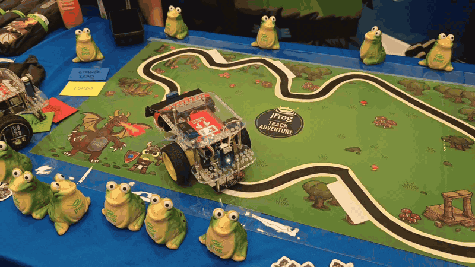

<!-- _class: hero mascota -->
<!-- _footer: "[ `conan.io`](https://conan.io) [`github.com/conan-io/ros-conan`](https://github.com/conan-io/ros-conan)" -->
<!-- _paginate: false -->
<!-- _header: "" -->


###### ROSCon España 2026 · Valencia

# ROS sin rodeos

## Desarrollo nativo en *C++* para robótica

**Daniel Manzaneque**
Ingeniero Software · Conan / JFrog

<!--
⏱ 0:00 → 0:30
Hola a todos. Soy Daniel Manzaneque, ingeniero de software en el equipo de Conan, en JFrog.

Soy ingeniero industrial y antes de dedicarme al software trabajé con robots. Mi tesis la hice con ROS 1, en tiempos de Indigo.

Hoy os quiero contar cómo usar ROS sin rodeos, con una experiencia de desarrollo nativa en C++.
-->

---

###### El punto de partida

## «Solo quería publicar un topic desde mi código *C++*»

Un robot pequeño, con una placa tipo Raspberry Pi y su control en C++. Antes de escribir una línea útil, hay que:

1. Tener la versión de Ubuntu que pide la distro
2. Instalar con `apt` y `rosdep` todo lo demás
3. Crear un workspace de colcon con su estructura
4. Escribir `package.xml` y adaptar el CMake a `ament_cmake`
5. Acordarse de hacer `source setup.bash`

**Muchos pasos antes de llegar al robot**

<!--
⏱ 0:30 → 1:40
Para contarlo voy a usar un ejemplo que nos acompañará toda la charla: un robot pequeño, con un ordenador modesto, tipo Raspberry Pi. El control de los motores y la lectura de los sensores ya estaban escritos en C++.

Yo solo quería que ese código hablase ROS 2, para comunicarse con otros nodos para tareas como navegación o SLAM, o para incorporar otros sensores.

Pero antes de escribir una sola línea útil tenía que usar la versión de Ubuntu que pide la distro. Instalar paquetes de sistema que ni sabía para qué servían. Crear un workspace, convertir mi proyecto en un paquete de ROS y acordarme de ejecutar los scripts de entorno.

Muchos pasos antes de llegar al robot.
-->

---

<!-- _class: cards -->

###### El mapa de la charla

## Tres rodeos *mejorables*

1. **Instalar** ROS se instala en el sistema → ROS pasa a ser **una dependencia más**.
2. **Desarrollar** Tu proyecto se adapta a ROS → Tu **proyecto C++ de siempre**.
3. **Desplegar** Compilar en el robot o en la imagen de despliegue → **Construir fuera**, llevar solo lo necesario.

<!--
⏱ 1:40 → 2:40
A estos pasos los llamo rodeos: cosas que haces no porque aporten algo a tu robot, sino porque la herramienta te lo exige. En el equipo de Conan nos fijamos en tres que creemos que se pueden simplificar.

Al instalar, tratar ROS como una dependencia más, como cualquier librería. Al desarrollar, seguir con tu proyecto C++ de siempre. Y al desplegar, construir fuera y llevar al robot solo lo necesario.

Y quiero ser justo desde el principio: estos rodeos tienen su razón de ser. ROS los resolvió con herramientas que llevan años funcionando, por eso las usamos todos. Lo que os traemos es otro camino para cuando esos rodeos duelen.
-->

---

<!-- _class: herramienta -->

###### La herramienta

## Conan, el gestor de paquetes *open source* de C y C++

#### Código abierto (MIT)
- Mantenido por el equipo de Conan con el feedback de la comunidad

#### Cada librería es una **receta**
- Hay unas 2.000 recetas en ConanCenter y puedes crear las tuyas.

#### Agnóstico al build-system
- Compatible con CMake, Bazel, Meson, MSBuild...

#### Resuelve el **grafo** completo de dependencias transitivas
- Obtiene un **binario por configuración**, si no está disponible lo compila desde el código fuente.


<!--
⏱ 2:40 → 3:55
Y aquí entra Conan, la herramienta que nos permite hacer todo esto.

[Pregunta al público y pausa] ¿Conocéis Conan? (No me refiero al bárbaro.)

Conan es un gestor de paquetes y binarios para C y C++. Lo que pip es para Python, Conan lo es para C y C++.

- Es open source, igual que las recetas.

- Cada librería se describe en una receta. Las de librerías open source viven en ConanCenter, el repositorio público, y cualquiera puede tener su propio servidor.

- Funciona con cualquier sistema de build. CMake es el que mejor integración tiene.

- Y gestiona binarios: uno por configuración, es decir, sistema, arquitectura, compilador, Debug o Release. Si el binario no existe, Conan lo compila desde fuentes.
-->

---

<!-- _class: problema -->

###### Rodeo 1 · Instalar

## Una versión por sistema. Una imagen *por distro*

- **`apt` y `rosdep`**: instalan la versión que trae la distro. `package.xml` declara dependencias, pero no elige versiones
- **Docker**: congela esa foto y la hace repetible. Otra distro de ROS, otra imagen
- ¿Otra versión de una librería? La compilas a mano y nadie comprueba que no choque con la de ROS
- Y el desarrollo se muda dentro de la imagen, lejos de tu IDE

> `apt` y Docker resuelven bien la instalación. Lo que no ven es el grafo de tu proyecto.

<!--
⏱ 3:55 → 4:55
Empecemos por el primer rodeo: la instalación de ROS.

Todos habéis instalado ROS con apt y rosdep, atados a la versión de Ubuntu que pide la distro.

La solución habitual, y muy razonable, son las imágenes de Docker: una por distro de ROS, a la que sumáis vuestro software. Funciona y es repetible.

Pero dentro de la imagen, apt sigue instalando lo que trae la distro. Si necesitáis otra versión de una librería, la compiláis a mano y os aseguráis de que no choca. Y eso, una vez por cada imagen.

Ni el sistema ni el contenedor conocen el grafo de dependencias de vuestro proyecto.

[Si encaja: la charla anterior en esta sala habla de testing multidistro. Se puede enlazar con ella.]
-->

---

<!-- _class: solucion -->

###### Sin rodeos

## ROS es *una dependencia más*

###### `conanfile.txt`

```ini
[requires]
ros-kilted/2026.06.17
opencv/4.12.0
```

- ROS vive en la **caché de Conan**, no en `/opt/ros` ni en una imagen
- Varias distros de ROS en la misma máquina, **sin una imagen por distro**

```bash
conan install conanfile.txt --build=missing
```

- El mismo flujo en **Linux, macOS y Windows**

<!--
⏱ 4:55 → 5:45
¿Cómo lo resuelve Conan? Tratando a ROS como una dependencia más.

Esto es un conanfile.txt, el equivalente a un requirements.txt de Python. ROS Kilted aparece igual que cualquier otra librería, por ejemplo OpenCV.

Conan instala ROS en su caché, una carpeta en vuestro usuario. No va a /opt/ros ni a una imagen, así que no choca con el sistema. Y podéis tener varias distros de ROS en la misma máquina.

Basta un conan install, y es la misma experiencia en Linux, en macOS y en Windows.
-->

---

<!-- _class: solucion -->

###### El paquete

## ¿Qué es *`ros-kilted`*?

- **ROS 2 Kilted compilado desde fuentes**, empaquetado como un único paquete Conan
- **Versión = sincronización de rosdistro**: `2026.06.17` es el tag `kilted/2026-06-17`
- **Variantes** como los metapaquetes oficiales: `core`, `base`, `desktop`
  `-o ros-kilted/*:variant=desktop`
- Las **dependencias de terceros** (OpenSSL, Eigen, yaml-cpp, OpenCV…) vienen de ConanCenter: son nodos del grafo
- Incluye `ros2` y `colcon`: RViz y los **tutoriales oficiales** siguen funcionando

<!--
⏱ 5:45 → 6:35
¿Y qué es ese ros-kilted? ROS 2 Kilted compilado desde fuentes con colcon, dentro de una receta de Conan.

La versión es una fecha: el tag de sincronización de rosdistro del 17 de junio.

Tiene variantes como los metapaquetes oficiales: core, base y desktop, que trae RViz.

Las librerías de terceros, como OpenSSL, Eigen u OpenCV, no van dentro: vienen de ConanCenter y son nodos del grafo. Eso es importante para lo que viene ahora.

Y trae ros2 y colcon, así que los tutoriales oficiales siguen valiendo.
-->

---

<!-- _class: problema grafo -->

###### El grafo

## ROS, OpenCV y Eigen en el *mismo* grafo


**Este grafo no cierra.**

- `ros-kilted` (variante `desktop`) usa OpenCV 4.12. Mi nodo quiere la nueva 4.14
- En C++, dos OpenCV son **dos `cv::Mat`** en el mismo programa
- Conan lo detecta **al instalar**, antes de compilar una línea

<!--
⏱ 6:35 → 7:35
Como Conan conoce el grafo completo, puede comprobar que sea consistente. Mirad este caso.

Mi nodo quiere OpenCV 4.14, la última, porque necesito algo que solo está ahí. Pero ROS, en la variante desktop, usa OpenCV 4.12. Y cada OpenCV trae su propia libpng.

Eigen sale en verde: aparece una sola vez. Lo rojo son paquetes repetidos con versiones distintas.

Con dos OpenCV tendríamos dos cv::Mat en el mismo programa: puede fallar al enlazar o, peor, enlazar y fallar en ejecución.

Con apt, la distro solo trae una OpenCV. Si compiláis otra a mano, nadie comprueba si choca con la de ROS. Conan os avisa del conflicto al instalar.
-->

---

<!-- _class: solucion -->

###### El grafo · solución

## Si no cierra, *decides tú* y Conan recompila

###### `conanfile.py`

```python
class MiNodo(ConanFile):
    default_options = {"ros-kilted/*:variant": "desktop"}

    def requirements(self):
        self.requires("ros-kilted/2026.06.17")
        self.requires("opencv/4.14.0", force=True)
```

```bash
conan install conanfile.py --build=missing
```

- `force=True`: tu versión manda en todo el grafo, **también dentro de ROS**
- Lo que dependía de OpenCV se recompila: **un solo `cv::Mat`**

<!--
⏱ 7:35 → 8:20
¿Y cómo se arregla? Lo decide el usuario.

Pasamos a un conanfile.py y pedimos OpenCV 4.14 con force=True: esa versión manda en todo el grafo, también por encima de la que pide ROS.

Al instalar con --build=missing, Conan ve que el binario de ROS ya no corresponde a esa OpenCV y lo recompila. El resultado es un grafo consistente, con un solo cv::Mat.

Siendo honestos: hoy la receta de ROS es monolítica, así que recompilar ROS es recompilarlo entero.
-->

---

<!-- _class: problema -->

###### Rodeo 2 · Desarrollar

## Para usar ROS, tu proyecto tiene que *«hacerse ROS»*

- La estructura del workspace: `src/ build/ install/ log/`
- `package.xml` y macros de `ament_cmake` dentro de tu CMake
- `colcon build` en lugar de tu build de siempre
- El IDE no encuentra nada si no hiciste `source` antes de abrirlo
- Si ROS vive en una imagen, tu desarrollo también: IDE, depurador y volúmenes cruzan el contenedor

> Si ROS es solo una capa de un producto C++ grande, el rodeo lo paga **todo** el producto.

<!--
⏱ 8:20 → 9:25
Segundo rodeo: desarrollar. Hoy, para usar ROS, tu proyecto tiene que hacerse ROS.

Seguir la estructura del workspace, escribir un package.xml, meter macros de ament_cmake, compilar con colcon y acordarte de hacer source antes de abrir el IDE.

Si empezáis los proyectos desde cero en ROS, quizá no sea un problema. Pero pensad en mi robot, o en una empresa con años de código C++ que quiere hablar ROS. Tiene que reorganizar el proyecto alrededor de ROS, o mantener dos mundos en paralelo.

Y si ROS vive en una imagen de Docker, vuestro desarrollo también vive ahí. Los dev containers ayudan mucho, y si os funcionan, adelante. Pero para nosotros la imagen brilla de verdad al desplegar, no al desarrollar.
-->

---

<!-- _class: solucion -->

###### Sin rodeos

## Un proyecto CMake normal que *usa* ROS

###### `CMakeLists.txt`

```cmake
find_package(rclcpp REQUIRED)
find_package(OpenCV REQUIRED)

add_executable(my_node src/main.cpp)
target_link_libraries(my_node PRIVATE rclcpp::rclcpp opencv::opencv)
```

Instalar dependencias y compilar:

```bash
conan install conanfile.txt --build=missing
cmake --preset conan-release
cmake --build --preset conan-release
```

<!--
⏱ 9:25 → 10:25
Con Conan, esto es un proyecto CMake normal que usa ROS.

Como ROS es una dependencia más, sus librerías llegan por el find_package de siempre: rclcpp exactamente igual que OpenCV.

Y los pasos son los habituales: conan install resuelve las dependencias, y CMake configura y compila. Sin workspace, sin colcon y sin hacer source de nada. Y lo abrís directamente en vuestro IDE.

Es justo lo que hice con mi robot. El código de motores y sensores que ya tenía no cambió de estructura. Le añadí un conanfile.txt, un par de líneas en el CMake, y empezó a publicar sus topics.
-->

---

<!-- _class: pose -->

###### Ejemplo real · examples/pose_estimation

## Estimación de pose humana: *ROS + visión + ML*

```text
pose_estimation/
├── CMakeLists.txt
├── conanfile.txt
├── src/pose-estimation.cpp
└── assets/  # ML models
```

- Sin `package.xml`, sin `ament`, sin workspace.
- `ros-kilted`, `opencv` y `tensorflow-lite`, en un solo grafo.

<!--
⏱ 10:25 → 11:05
Un ejemplo real del repositorio: estimación de pose humana. Un modelo de IA estima la posición del cuerpo y publica los puntos en un topic de ROS.

A la izquierda, la imagen de la cámara con el esqueleto. A la derecha, RViz recibiendo esos puntos, lanzado también desde Conan.

Son unos pocos ficheros, sin workspace ni package.xml. ROS, OpenCV y TensorFlow Lite se resuelven en un único grafo con un conan install.
-->

---

<!-- _class: solucion compacta -->

###### ¿Ya tienes un workspace de colcon?

## Conan *dentro* de tu workspace

###### `mi_paquete/conanfile.txt`

```ini
[requires]
tensorflow-lite/2.15.0
[generators]
CMakeDeps
CMakeToolchain
ROSEnv
```

```bash
conan install mi_paquete/conanfile.txt --build=missing
source /opt/ros/kilted/setup.bash       # tu ROS de siempre
source install/conan/conanrosenv.sh
colcon build
```

- Tu CMake, sin nada de Conan: `find_package(tensorflowlite)`

<!--
⏱ 11:05 → 12:10
¿Y si ya tenéis un workspace de colcon? Será el caso de la mayoría.

Podéis hacer el camino inverso: meter Conan dentro de ROS. Es probablemente la forma más fácil de empezar.

El año pasado añadimos a Conan el generador ROSEnv. En el paquete que necesita una librería de terceros, por ejemplo TensorFlow Lite, añadís un conanfile.txt con esa librería y el generador ROSEnv.

Hacéis conan install, activáis vuestro ROS de siempre, después el entorno de Conan, y colcon build como siempre. En vuestro CMake no hay nada de Conan, un find_package de siempre.

Si solo os quedáis con una cosa de esta charla, que sea esta: podéis probar Conan mañana en vuestro workspace sin cambiar nada más.
-->

---

<!-- _class: problema -->

###### Rodeo 3 · Desplegar

## Llevar el código *al robot*

- **Compilar en el robot**: viable en una Jetson, muy lento en una placa modesta
- **Replicar el entorno de desarrollo en el robot**: herramientas y dependencias que el robot no necesita para funcionar
- **Copiar la carpeta `install/`**: rutas absolutas y librerías que faltan o sobran en el robot
- **¿Qué hay realmente instalado en el robot?** Difícil de contestar cuando lo pregunta un cliente, una auditoría o aparece un CVE

<!--
⏱ 12:10 → 12:55
Último rodeo: desplegar. ¿Cómo llevamos el código al robot?

¿Compilamos en el robot? En una Jetson se puede, pero en una placa como la mía es lentísimo. ¿Replicamos el entorno de desarrollo? El robot acaba cargando con compiladores y cabeceras que no necesita. ¿Copiamos la carpeta install? Faltan las librerías de ROS del sistema.

Y una pregunta más: si os lo pregunta un cliente, una auditoría o aparece un CVE, ¿sabríais decir qué hay instalado en el robot?
-->

---

<!-- _class: solucion compacta -->

###### Sin rodeos

## Compilar en tu máquina, *ejecutar en el robot*

###### `robot_arm64` · perfil host
```ini
[settings]
os=Linux
arch=armv8
compiler=gcc
compiler.version=13
[tool_requires]
arm-gnu-toolchain/13.3
```

```bash
conan install conanfile.txt --profile:build=default --profile:host=robot_arm64
```

- **Build**: tu portátil, donde corren CMake y el compilador cruzado
- **Host**: el robot (ARM), al que van tu código y sus librerías

<!--
⏱ 12:55 → 14:05
Conan separa dos contextos, y cada uno se describe en un perfil.

El de build es tu portátil: ahí corren CMake y el compilador cruzado. El de host es el robot, con su arquitectura ARM: para él van tu código y sus librerías.

Este es el perfil del robot: sistema, arquitectura y compilador, todo lo que afecta al binario. Y pide el compilador cruzado como un paquete más, aquí el Arm GNU Toolchain en una receta propia. Así todo el equipo compila con el mismo compilador.

Le pasáis los dos perfiles a conan install, genera el toolchain de CMake para compilar en cruzado, y compiláis igual que antes.

En mi caso, el portátil hace todo el trabajo pesado y la placa del robot solo se dedica a ejecutar.
-->

---

<!-- _class: solucion -->

###### Sin rodeos

## Llevar al robot *solo lo que necesita*

```bash
conan install conanfile.txt -pr:h=robot_arm64 --deployer=runtime_deploy --deployer-folder=robot
```

- Viaja solo el **runtime**: los ejecutables y las librerías dinámicas que tu nodo necesita para arrancar
- Se quedan en tu máquina las **herramientas de build**: CMake, compiladores, cabeceras, generadores
- Una carpeta: `scp` o una imagen mínima. El robot **no necesita Conan**

<!--
⏱ 14:05 → 15:05
¿Y qué llevamos al robot? Para eso Conan tiene los deployers: recogen lo necesario de cada paquete y lo dejan en una carpeta.

Como Conan sabe qué se ejecuta y qué solo sirve para compilar, runtime_deploy copia solo los ejecutables y las librerías dinámicas. CMake, compiladores y cabeceras se quedan en vuestra máquina.

La carpeta la copiáis con scp o la metéis en una imagen mínima, y el robot no necesita Conan.

Con mi robot, lo que viaja es mi nodo y las librerías de ROS que usa, nada más. Ocupa mucho menos que una imagen con todo el entorno de desarrollo.

[Si tengo el dato: X MB de la carpeta frente a Y GB de la imagen.]
-->

---

<!-- _class: solucion -->

###### Sin rodeos

## Qué va en cada robot: *lockfile y SBOM*

```bash
conan lock create . -pr:h=robot_arm64 --lockfile-out=robot.lock
conan install . -pr:h=robot_arm64 --lockfile=robot.lock   # genera sbom.cdx.json
conan audit list --sbom=sbom.cdx.json
```

- **El cliente** pregunta qué versión lleva su robot: el **lockfile** fija todo el grafo, hoy y dentro de un año
- **La auditoría** pide el **SBOM**: el inventario de todo el software del robot, en CycloneDX, generado con un hook en `conan install`
- **Aparece un CVE**: `conan audit` revisa ese SBOM contra vulnerabilidades conocidas

<!--
⏱ 15:05 → 15:55
Y volvemos a la pregunta incómoda: ¿sabéis qué hay en cada robot?

El cliente. conan lock create guarda las versiones exactas de todo el grafo. Instalando con ese lockfile, hoy o dentro de un año, obtenéis exactamente lo mismo. Y para quien investiga, es reproducir el entorno de un experimento años después.

La auditoría. conan install deja un SBOM en CycloneDX: el inventario de componentes y versiones que va en el robot. Cada vez se exige más a los fabricantes.

Y el CVE. conan audit revisa ese SBOM contra vulnerabilidades conocidas.
-->

---

<!-- _class: video -->

###### Volviendo a mi robot

## Mi robot, *sin rodeos*



ROSCon Global 2026 · Toronto

<!--
⏱ 15:55 → 16:45
Y volviendo a mi robot pequeño, el del principio.

Aquí lo tenéis en el stand de Conan en ROSCon Global, en Toronto, siguiendo la línea del circuito.

El mismo código C++ de siempre, hablando ROS, sin haber instalado ROS en el robot.
-->

---

###### Resumen

## Los tres rodeos, *simplificados*

| | Habitual | Conan |
|---|---|---|
| Instalar | El sistema, o una imagen por distro | Una dependencia más en la caché. Grafo consistente |
| Desarrollar | Workspace, `package.xml`, `ament`, `colcon` | CMake de siempre y `find_package`. O ROSEnv en tu workspace |
| Desplegar | Compilar en el robot, replicar el entorno o copiar `install/` | Perfiles build/host, `runtime_deploy`, lockfile y SBOM |

<!--
⏱ 16:45 → 17:10
Resumiendo. Para instalar, ROS es una dependencia más, con un grafo consistente. Para desarrollar, vuestro CMake de siempre, o ROSEnv en vuestro workspace. Y para desplegar, perfiles de build y host, solo el runtime en el robot, y lockfile y SBOM para saber qué lleva cada uno.
-->

---

###### Pruébalo hoy

## Necesitamos *vuestro feedback*

- Recetas y ejemplos en [github.com/conan-io/ros-conan](https://github.com/conan-io/ros-conan)
- Probado en CI: **Linux** (x86_64 y arm64), **macOS** y **Windows**
- **Ejemplos**: CMake puro, workspace de colcon, pose_estimation (OpenCV + TensorFlow Lite)

Issues, ideas y críticas: **todas bienvenidas**

<!--
⏱ 17:10 → 17:50
Todo esto lo podéis probar ya en el repositorio ros-conan, con CI en Linux, también en ARM, en macOS y en Windows, y con varios ejemplos.

Es una prueba de concepto: de momento solo Kilted y sin binarios precompilados. Cada caso es un mundo, y por eso necesitamos conocer los vuestros. Si os falta un paquete, una distro o una plataforma, abrid un issue.

Estaré encantado de hablar con vosotros después.
-->

---

<!-- _class: mascota -->
<!-- _footer: "[ `conan.io`](https://conan.io) [`github.com/conan-io/ros-conan`](https://github.com/conan-io/ros-conan)" -->
<!-- _paginate: false -->
<!-- _header: "" -->


###### ¡Gracias!

# ¿*Preguntas*?

Prueba los ejemplos:
- [github.com/conan-io/ros-conan](https://github.com/conan-io/ros-conan/tree/main/examples)

Más info:
- *Bringing ROS into your native C/C++ workflow with Conan* - `discourse.openrobotics.org`
- *Robotics with Conan: consuming ROS as a regular package* - `blog.conan.io`

<!--
⏱ 17:50 → 18:10. Preguntas hasta 20:00.
Y nada más, muchas gracias a todos. Si tenéis preguntas, este es el momento, y si no da tiempo, lo comentamos después. ¡Gracias!
-->

<!--
DIAPOSITIVA OCULTA · Siendo honestos (útil para preguntas)
Para recuperarla, pégala como diapositiva entre «Resumen» y «Pruébalo hoy».

###### Siendo honestos

## Es una *prueba de concepto*

- **Receta monolítica**: toda la distro en un paquete. Cambiar una dependencia recompila ROS entero
- **Sin binarios precompilados**: el primer `conan install` compila ROS desde fuentes
- **Solo ROS Kilted**, con las variantes `core`, `base` y `desktop`
- **Sin probar a fondo**: interfaces propias (IDL) fuera de colcon, paquetes fuera de las variantes (Nav2, MoveIt…)

Notas:
Hay que ser honestos y también explicar las limitaciones. Esto es una prueba de concepto para poner de manifiesto los puntos en los que creemos que una herramienta como Conan puede ayudar a los desarrolladores de ROS. Hay aspectos mejorables que no invalidan lo anterior:
La receta es monolítica: toda la distro va en un único paquete. Es lo más sencillo para empezar, pero si cambiáis una dependencia, como la OpenCV de antes, se recompila ROS entero.
No hay binarios precompilados. El primer conan install compila ROS desde fuentes, y eso lleva su tiempo. Después queda en la caché o en vuestro servidor y no se repite.
Disponemos de ROS Kilted, en sus variantes core, base y desktop.
Y hay cosas que no hemos probado. Aquí es cuando entráis vosotros.
-->
