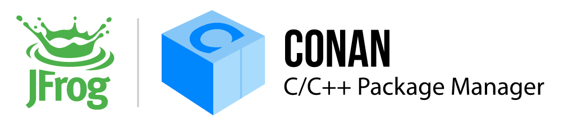

<!-- _class: hero mascota -->
<!-- _footer: "[ `conan.io`](https://conan.io) [`github.com/conan-io/ros-conan`](https://github.com/conan-io/ros-conan)" -->
<!-- _paginate: false -->
<!-- _header: "" -->




###### ROSCon España 2026 · Valencia

# ROS sin rodeos

## Desarrollo nativo en *C++* para robótica

**Daniel Manzaneque**
Ingeniero Software · Conan / JFrog

<!--
⏱ 0:00 → 0:30
Preséntate en una frase: Daniel, Software Engineer en el equipo de Conan en JFrog.
Conan no lo expliques aquí: la sala conoce ROS y, muy probablemente, no Conan. Va una diapositiva solo para eso, justo después del mapa.
Idea que quieres dejar desde el principio: si programas en C++, usar ROS no debería obligarte a dar un rodeo.
-->

---

###### De dónde venimos...

## Un robot pequeño con un ordenador *modesto*

- Una placa con pocos recursos (tipo Raspberry Pi)
- Control y percepción escritos en **C++**
- **ROS 2** para hablar con sensores, herramientas y otros equipos


<!--
⏱ 0:30 → 1:30
Hilo conductor de tu charla de Toronto: cuenta en un minuto la historia del robot.
Lo importante es la sensación: "yo solo quería programar mi robot en C++, y ROS me hacía dar vueltas".
Para poner la foto, sustituye el bloque de cita por: 
-->

---

###### El punto de partida

## «Solo quería publicar un topic desde mi código *C++*»

Antes de escribir una línea útil, hay que:

1. Tener la versión de Ubuntu que pide la distro
2. Instalar con `apt` y `rosdep` todo lo demás
3. Crear un workspace de colcon con su estructura
4. Escribir `package.xml` y adaptar el CMake a `ament_cmake`
5. Acordarse de hacer `source setup.bash`

**Demasiadas cosas antes de llegar al robot. Y un condicionante más...**

- Estoy desarrollando en Windows

<!--
⏱ 1:30 → 2:30
Pregunta a la sala: "¿A quién se le ha olvidado alguna vez el source?" Suele haber risas y manos.
No es una crítica a ROS: todo esto tiene sentido dentro del ecosistema.
El problema es para quien viene del mundo C++ y ya tiene su forma de trabajar.
-->

---

<!-- _class: cards -->

###### El mapa de la charla

## Tres rodeos *prescindibles*

1. **Instalar** ROS se instala en el sistema → ROS pasa a ser **una dependencia más**.
2. **Desarrollar** Tu proyecto se adapta a ROS → Tu **proyecto C++ de siempre**.
3. **Desplegar** Compilar en el robot y cruzar los dedos. → **Construir fuera**, llevar solo lo necesario.

<!--
⏱ 2:30 → 3:10
Mapa de la charla. Sigues el ciclo de vida del robot de Toronto: instalar, desarrollar, desplegar.
Para cada fase: un problema concreto y cómo lo resolvemos con Conan.
No definas Conan todavía: la siguiente diapositiva es solo eso, en cuatro frases.
-->

---

###### La herramienta

## Conan, el gestor de paquetes *open source* de C y C++

#### Código abierto (MIT)
- Mantenido el equipo de Conan en JFrog con el feedback de la comunidad

#### Cada librería es una **receta**
- Hay miles en ConanCenter (repositorio central) y puedes crear las tuyas.

#### Resuelve el **grafo** completo de dependencias transitivas
- Obtiene un **binario por configuración**. Puede compilar desde fuentes.

#### Agnóstico al build-system
- Compatible con CMake, Bazel, Meson, MSBuild...

<!--
⏱ 3:10 → 4:00
Cuatro ideas, y para. No abras el manual: nada de package_id, revisiones ni opciones.
1. Es un proyecto open source, no un producto cerrado. El código y las recetas se pueden leer.
2. La unidad es la receta. ConanCenter es el repositorio público; el remoto puede ser también el vuestro.
   Esto prepara el final: las recetas de ROS todavía no están en ConanCenter.
3. Un binario por configuración (sistema, arquitectura, compilador, Debug o Release). Si falta, se compila una vez.
4. No pide cambiar de build system. El grafo se explica al instalar; el perfil, al desplegar.
-->

---

<!-- _class: problema -->

###### Rodeo 1 · Instalar

## El sistema es solo uno. La imagen, *también*

- **`apt` y `rosdep`**: la versión de la distro. Lo que pongas en `package.xml` no manda
- **Docker**: congelas esa foto. Otra ROS distro, otra imagen
- Dentro sigue sin haber grafo: dos OpenCV pueden colarse y enlazar igual
- Desarrollas dentro: el IDE y el robot se quedan fuera

> Ni el gestor del sistema ni el contenedor sirven para desarrollar: no tienen el grafo de tu proyecto.

<!--
⏱ 4:00 → 5:10
Apt y Docker son los dos reflejos de la sala. No los ridiculices: di la carencia que comparten.
Ejemplo vivido: Humble en producción y Kilted en el portátil. La respuesta habitual es una imagen por distro.
Dentro de la imagen, rosdep sigue instalando lo que haya. Nadie comprueba que solo exista una OpenCV.
El IDE, el depurador y el hardware quedan al otro lado del contenedor.
Docker como forma de *entregar* el robot sigue valiendo: lo verás en el deployer. Lo que no vale es desarrollar ahí.
Si sale: en macOS y Windows ni siquiera hay este camino oficial.
La charla anterior en esta misma sala trata el testing multidistro: si encaja, enlaza con ella.
-->

---

<!-- _class: solucion -->

###### Sin rodeos

## ROS es *una dependencia más*

###### `conanfile.txt`

```ini
[requires]
ros-kilted/2026.06.17
opencv/4.12.0
```

- ROS vive en la **caché de Conan**, no en `/opt/ros` ni en una imagen
- Varias distros de ROS en la misma máquina, **sin una imagen por distro**

```bash
conan install conanfile.txt --build=missing
```

- El mismo flujo en **Linux, macOS y Windows**

<!--
⏱ 5:10 → 6:00
Un requires más, igual que OpenCV. Ese es todo el mensaje de la diapositiva.
Nombra Docker. La sala vive ahí. El contenedor no resuelve versiones: el grafo, sí. La siguiente diapositiva es ese grafo, dibujado.
(Simplificado: en el repo se usa además el perfil profiles/ros, que fija C++17 y la versión de CMake. El perfil se explica al desplegar; aquí no.)
-->

---

<!-- _class: solucion grafo -->

###### El grafo

## ROS, OpenCV y Eigen en el *mismo* grafo


**Este grafo no cierra.**

- **Conflicto de versiones.** Dos OpenCV, dos libpng: Conan no resuelve
- **Consistencia.** La imagen no la garantiza. Un paquete, un solo nodo
- **Una sola definición.** Dos OpenCV son dos `cv::Mat` en el mismo programa

<!--
⏱ 6:00 → 7:30
No leas el esquema. Señálalo. Rojo: hay dos versiones. Verde: un solo nodo, Eigen.
1. Conflicto: hay dos OpenCV y, sin que nadie las pidiera, dos libpng. En apt o en la imagen esto enlaza y parece que funciona.
2. Consistencia: Eigen entra por ROS. Si tu código también lo pide, tiene que ser ese mismo nodo. No es una propiedad de "estar en el mismo Ubuntu": hay que resolver el grafo. Se da por hecha y no lo es.
3. ODR, la One Definition Rule: dilo si quieres, la slide ya no lleva la sigla. En un programa C++ cada entidad tiene una sola definición. Dos OpenCV son dos `cv::Mat`. El linker no elige por ti. Conan ni siquiera llega a enlazar. El mismo compilador y el mismo ABI son la otra mitad: una sola versión compilada de otra forma también son dos definiciones.
El grafo que sí cierra tiene una sola opencv/4.12 y una sola libpng, y la de ROS tiene que aceptar esa versión. Si no puede, no compilas.
El lockfile (conan.lock) congela ese grafo cerrado. Una frase, y sigues: saldrá otra vez en el resumen.
Las versiones son para la historia. Si ros-kilted no depende de OpenCV directamente, di cv_bridge o el paquete de visión que sí lo haga: el mecanismo es el mismo.
-->

---

###### Ejemplo concreto

## «Necesito otra versión de *OpenCV*»

### Antes
En `apt`, o en la imagen de Ubuntu, hay una OpenCV.
¿Quieres otra? La compilas dentro y esperas que no choque con la de ROS.

### Ahora
La versión va en el `conanfile.txt`.
Es el conflicto del grafo anterior: o encaja, o no se compila.

<!--
⏱ 7:30 → 8:10
El caso que más resuena con quien ha sufrido ROS y visión. No repitas la teoría: señala el árbol anterior.
Dato para dar color (verifícalo antes): Ubuntu 24.04 trae OpenCV 4.6 en apt. Las imágenes oficiales de ROS parten de esa misma base.
-->

---

<!-- _class: problema -->

###### Rodeo 2 · Desarrollar

## Para usar ROS, tu proyecto tiene que *«hacerse ROS»*

- La estructura del workspace: `src/ build/ install/ log/`
- `package.xml` y macros de `ament_cmake` dentro de tu CMake
- `colcon build` en lugar de tu build de siempre
- El IDE no encuentra nada si no hiciste `source` antes de abrirlo
- Librerías de terceros: unas de `apt`, otras copiadas al repo, otras a mano

> Si ROS es solo una capa de un producto C++ grande, el rodeo lo paga **todo** el producto.

<!--
⏱ 8:10 → 9:00
Piensa en una empresa con un código C++ de años (control, visión, planificación) que quiere "hablar ROS".
Hoy tiene que reorganizar el proyecto alrededor de las convenciones de ROS, o mantener dos mundos en paralelo.
-->

---

<!-- _class: problema -->

###### Rodeo 2 · Desarrollar

## Desarrollar *dentro* de la imagen

- Compilas con la RAM, los núcleos y las herramientas de la imagen del robot
- El IDE no vive ahí: el índice, los breakpoints y el depurador cruzan el contenedor
- Volúmenes, permisos y `docker exec`: cada compilación y cada depuración van más lentas

> La imagen sirve para desplegar en el robot no para desarrollo.

<!--
⏱ 9:00 → 9:40
Rodeo 1 ya dijo que el contenedor no es para desarrollar. Aquí el coste, sin repetir el grafo.
La sala vive en Docker: no lo ridiculices. Entregar el robot en una imagen sigue valiendo; sale en el deployer.
1. Misma imagen para el robot y el portátil. O le faltan recursos para compilar, o el robot se lleva el toolchain de desarrollo.
2. El autocompletado, los breakpoints y gdb quedan al otro lado. Un dev container ayuda, y sigue siendo un puente.
3. Cada ciclo pasa por volúmenes, usuarios y docker exec. Compilar y depurar se alargan.
La siguiente diapositiva es la salida: tu CMake y tu IDE, en la máquina.
-->

---

<!-- _class: solucion -->

###### Sin rodeos

## Un proyecto CMake normal que *usa* ROS

###### `CMakeLists.txt`

```cmake
find_package(rclcpp REQUIRED)
find_package(OpenCV REQUIRED)

add_executable(my_node src/main.cpp)
target_link_libraries(my_node PRIVATE rclcpp::rclcpp opencv::opencv)
```

Instalar dependencias y compilar:

```bash
conan install conanfile.txt --build=missing
cmake --preset conan-release
cmake --build --preset conan-release
```

<!--
⏱ 9:40 → 10:30
Destaca que los find_package son los de siempre: se usan los ficheros de configuración que instala el propio ROS.
No hemos reinventado ROS: lo hemos puesto donde un proyecto CMake espera encontrarlo.
Punto fuerte que ya anunciaste: Conan no impone un build system. Genera el preset y se aparta.
Y sales de la imagen: compilas y depuras en tu máquina. La imagen vuelve al final, solo para entregar.
-->

---

<!-- _class: pose -->

###### Ejemplo real · examples/pose_estimation

## Estimación de pose humana: *ROS + visión + ML*

```text
pose_estimation/
├── CMakeLists.txt
├── conanfile.txt
├── src/pose-estimation.cpp
└── assets/  # ML models
```

- Sin `package.xml`, sin `ament`, sin workspace.
- Todo se instala con un `conan install`

<!--
⏱ 10:30 → 11:20
Señala el layout: un CMakeLists, un conanfile, un cpp. No hay workspace ni package.xml.
Las tres directas (ros-kilted, opencv, tensorflow-lite) cierran en un solo grafo. Una OpenCV, una sola definición. Lo contrario del grafo rojo.
Si puedes, enseña el GIF del ejemplo (assets/output.gif) en el portátil.
-->

---

<!-- _class: tools -->

###### Las herramientas de siempre

## …y `ros2` *sigue funcionando*

```bash
conan run "ros2 run rviz2 rviz2"
```

- Variantes según lo que necesites:
  `core` → `base` → `desktop`
- Los **tutoriales oficiales** siguen siendo válidos

<!--
⏱ 11:20 → 11:55
Mensaje para los "ROSeros" de la sala: no os quitamos nada.
turtlesim viene en la variante desktop. Si tienes una captura de turtlesim abriéndose, este es el sitio.
-->

---

<!-- _class: solucion -->

###### ¿Y en colcon?

## No hay problema: Conan *dentro* del workspace

```bash
conan install conanfile.txt --generator=ROSEnv
source install/conan/conanrosenv.sh
colcon build
```

- Añade librerías de ConanCenter a un workspace: `opencv`, `tensorflow-lite`, `eigen`...
- Sin tocar el sistema y sin copiar código de terceros al workspace
- Es el camino inverso: **Conan entra en ROS**

<!--
⏱ 11:55 → 12:45
Importante para no asustar a nadie: no pedimos migrar todo.
Hay dos caminos: ROS dentro de un proyecto C++ (lo que acabas de enseñar) o Conan dentro de un workspace ROS (esto).
Este segundo camino lo presentamos en el blog de Conan en 2024.
-->

---

<!-- _class: problema -->

###### Rodeo 3 · Desplegar

## Llevar el código *al robot*

- **Compilar en el robot**: Inviable o impráctico
- **Compilación cruzada**: toolchains, sysroots y scripts difíciles de configurar
- **Copiar la carpeta `install/`**: rutas absolutas y librerías que faltan o sobran en el robot
- **¿Qué hay realmente instalado en el robot?** Difícil de contestar cuando lo pregunta un cliente, una auditoría o aparece un CVE

<!--
⏱ 12:45 → 13:35
Vuelve al robot de Toronto: aquí va tu anécdota de compilar en la placa (tiempo, memoria, swap...).
Pregunta a la sala: "¿Quién ha compilado ROS en una Raspberry?"
El tercer punto (toolchains que solo entiende una persona) lo resuelve la diapositiva del perfil, no esta.
-->

---

<!-- _class: solucion -->

###### Sin rodeos

## Compilar en tu máquina, *ejecutar en el robot*

```text
perfil build  →  tu portátil (x86_64)   →  herramientas: CMake, ros2 CLI, generadores…
perfil host   →  el robot (ARM)         →  tu código y sus librerías
```

```bash
conan install conanfile.txt --profile:build=default --profile:host=robot_arm64
cmake --preset conan-release           # <-- Toolchain de cross-build
cmake --build --preset conan-release 
```

- La configuración se describe **una vez** en un perfil: sistema, arquitectura y compilador
- **Contextos diferentes**: Conan separa lo que compila en tu máquina de lo que va al robot

<!--
⏱ 13:35 → 14:25
Concepto clave: dos contextos. Las herramientas se compilan para tu máquina; tu código, para el robot.
No abras todavía el fichero del perfil: la siguiente diapositiva es eso, con el toolchain incluido.
Los binarios se pueden subir a un servidor (p. ej. Artifactory) para que nadie vuelva a compilarlos. Es el punto fuerte que anunciaste al presentar Conan: un binario por configuración.
⚠ Antes de la charla: confirma hasta dónde está probada la compilación cruzada de ros-kilted.
Si no está probada de punta a punta, preséntalo como "la dirección en la que vamos".
-->

---

<!-- _class: solucion -->

###### Sin rodeos

## El perfil, y el toolchain como *paquete*

###### `robot_arm64 (profile:host)`
```ini
[settings]
os=Linux
arch=armv8
compiler=gcc
compiler.version=13
...

[tool_requires]
arm-toolchain/13.2
```

- El compilador cruzado corre en tu máquina y genera binarios para el robot
- Un paquete más en el grafo: versión fija, igual que cualquier librería

<!--
⏱ 14:25 → 15:20
Ojo con la palabra: en la diapositiva anterior, «toolchain» es el fichero que Conan genera para CMake. Aquí es el compilador cruzado, empaquetado.
Recorre el perfil de arriba abajo, sin leer cada clave.
Los settings describen la máquina de destino. libstdc++11 no es un detalle menor: es el ABI, la mitad de la ODR que enseñaste en el grafo. Dos binarios solo se mezclan si coinciden en esto. Tampoco lo garantiza la imagen.
tool_requires son herramientas del contexto de build, no librerías del robot. El ejemplo arm-toolchain/13.2 es el de la documentación de Conan (cross-build a Raspberry Pi): el compilador cruzado se empaqueta, corre en el portátil y sabe para qué arquitectura genera código.
El mismo mecanismo sirve para CMake o Ninja: dejan de ser "lo que hubiera instalado en el sistema". Menciónalo de palabra; no hace falta otra diapositiva.
No enseñes la receta del toolchain. Basta la idea: el compilador también tiene versión, y entra en el grafo.
Misma cautela que antes: si el cruce de ros-kilted no está probado de punta a punta, esto es la dirección, no un demo cerrado.
-->

---

<!-- _class: solucion -->

###### Sin rodeos

## Llevar al robot *solo lo que necesita*

```bash
conan install conanfile.txt -pr:h=robot_arm64 --deployer=runtime_deploy --deployer-folder=robot
```

- Viaja el **runtime**: `rclcpp`, `rmw`, los mensajes. Unas decenas de librerías
- Se quedan las **herramientas**: CMake, `ament`, los generadores. Casi dos mil nodos
- Una carpeta: `scp` o una imagen mínima. El robot **no necesita Conan**
- **SBOM** del grafo (CycloneDX): qué versión de qué va en cada robot

<!--
⏱ 15:20 → 16:10
runtime_deploy es ese corte: binarios y librerías compartidas, sin las herramientas. full_deploy copia el árbol completo; dilo solo si preguntan.
Números de examples/minimal_cpp_node: 54 nodos de runtime (host) y 1902 de build. CMake sale centenares de veces, una por receta.
Si el portátil aguanta, abre graph.html y quita «Show build-requires»: el grafo se vacía. Eso es lo que no viaja.
No pongas una captura: con todo encendido es una mancha; sin herramientas, una columna de nombres que no se lee desde la sala.
⚠ Verifica con el ejemplo qué deployer basta para un nodo ROS: ROS carga RMW y plugins de forma dinámica
y usa recursos del ament index, así que puede hacer falta full_deploy.
El SBOM conecta con seguridad y cumplimiento normativo: un argumento potente para la industria.
-->

---

###### Resumen

## Los tres rodeos, *simplificados*

| | Habitual | Conan |
|---|---|---|
| Instalar | El sistema, o una imagen por distro | La caché: varias distros conviven |
| Versiones | Lo que den `apt` y `rosdep` | Un grafo consistente y un lockfile |
| Desarrollar | Workspace, `package.xml`, `ament`, `colcon` | CMake de siempre y `find_package` |
| Desplegar | Compilar en el robot o scripts frágiles | Perfiles build/host, deployers y SBOM |

<!--
⏱ 16:10 → 16:45
No leas la tabla. Una frase: "el desarrollador C++ trabaja como siempre, y ROS se adapta a él".
Si te sobra un segundo: la fila de instalar es apt y Docker; la de desarrollar, el workspace y la imagen; la de versiones es el conflicto, la ODR y el lockfile.
-->

---

###### Siendo honestos

## Esta es nuestra visión. Necesitamos *vuestro feedback*

- Recetas listas en [github.com/conan-io/ros-conan](https://github.com/conan-io/ros-conan)
- Distribución disponible hoy: **ROS Kilted**
- Probado en **Linux (gcc 13)**, **macOS (Clang)** y **Windows (MSVC)**
- **Múltiples ejemplos**: CMake puro, colcon workspace, conan workspace, pose_estimation (OpenCV + TensorFlow)

Issues, ideas y críticas: **todas bienvenidas**

<!--
⏱ 16:45 → 17:20
Ser transparente genera confianza: no estás vendiendo un producto terminado, aunque vengas de una empresa.
Vuelve al principio: es open source. Las recetas están en el repo, se leen y se discuten. Por eso pides ayuda.
Deja el enlace en pantalla: está en grande para que lo apunten. No lo deletrees.
En Windows hay que activar las rutas largas antes del conan install (por si alguien pregunta).
-->

---

<!-- _class: mascota -->
<!-- _footer: "[ `conan.io`](https://conan.io) [`github.com/conan-io/ros-conan`](https://github.com/conan-io/ros-conan)" -->
<!-- _paginate: false -->
<!-- _header: "" -->


###### ¡Gracias!

# ¿*Preguntas*?

Prueba los ejemplos:
- [github.com/conan-io/ros-conan](https://github.com/conan-io/ros-conan/tree/main/examples)

Más info:
- *Bringing ROS into your native C/C++ workflow with Conan* - `discourse.openrobotics.org`
- *Robotics with Conan: consuming ROS as a regular package* - `blog.conan.io`

<!--
⏱ 17:20 → 19:20. Un minuto o dos, no más.
Si la sala arranca, una pregunta. Si nadie pregunta, no rellenes: "¿Quién mantiene más de una distro, cada una en su imagen?" y al pasillo.

- ¿Os encaja trabajar con **CMake puro** frente a colcon?
- ¿Os ayudaría probar contra **varias distros** sin contenedores?
- ¿Qué **librerías y SDKs de hardware** necesitáis junto a ROS?
- ¿Qué **distros y plataformas** priorizamos?
-->
